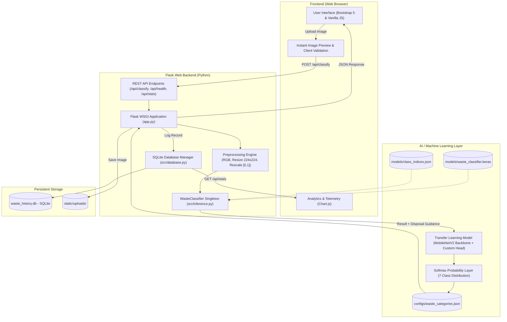

# Smart Waste Classification System Using AI/ML

[](https://www.python.org/)
[](https://flask.palletsprojects.com/)
[](https://tensorflow.org/)
[](https://getbootstrap.com/)
[](https://sqlite.org/)

An end-to-end, full-stack Artificial Intelligence application designed for automated municipal solid waste sorting and educational recycling guidance. Built as an academic mini-project for 3rd-year BTech Computer Engineering students.

---

## 1. System Architecture



---

## 2. Supported Waste Categories

The classifier distinguishes between 7 distinct categories based on the benchmark **TrashNet** dataset augmented with **Wet / Organic Waste**:

| Category | Stream Type | Suggested Bin | Educational Disposal Advice |
| :--- | :--- | :--- | :--- |
| **Cardboard** | Recyclable | Blue Bin (Paper) | Flatten boxes to save container volume. Remove packing tape and styrofoam inserts. |
| **Glass** | Recyclable | Green Bin (Glass) | Empty and rinse thoroughly. Separate metal or plastic lids before binning. |
| **Metal** | Recyclable | Blue/Yellow Bin | Lightly rinse beverage cans and food tins. Crush cans if local rules permit. |
| **Organic (Wet Waste)** | Biodegradable | Green Bin (Wet/Compost) | Food leftovers, fruit/vegetable peels, tea leaves for composting or biogas. Drain excess liquids. |
| **Paper** | Recyclable | Blue Bin (Paper) | Keep dry and clean. Remove plastic spirals. Do not recycle soiled napkins. |
| **Plastic** | Recyclable | Yellow/Blue Bin | Inspect resin code (#1 PET, #2 HDPE, #5 PP). Rinse, crush, and replace cap. |
| **Trash** | Residual | Black/Grey Bin | Non-recyclable composite or soiled waste. Bag securely for general landfill disposal. |

*Disclaimer: Recommendations are educational. Always follow your local municipal council's color codes and recycling regulations.*

---

## 3. Technology Stack

- **Programming Language:** Python (3.10 - 3.13)
- **Deep Learning Framework:** TensorFlow & Keras 3.x
- **Model Architecture:** Custom 3-block Convolutional Neural Network (CNN)
- **Backend Web Server:** Flask 3.x (WSGI)
- **Database:** SQLite 3 (Embedded, zero-configuration)
- **Frontend Framework:** HTML5, CSS3, Bootstrap 5.3, Bootstrap Icons
- **Data Visualization:** Chart.js 4.x
- **Evaluation & Preprocessing:** Pillow, NumPy, Scikit-learn, Matplotlib

---

## 4. Project Directory Structure

```text
smart-waste-classification/
├── app.py                     # Flask web server & REST API endpoints
├── requirements.txt           # Project dependencies
├── README.md                  # Comprehensive documentation & viva guide
├── train.py                   # Local CNN training pipeline with early stopping
├── evaluate.py                # Model evaluation (Accuracy, F1, Confusion Matrix)
├── predict.py                 # Standalone CLI image prediction tool
├── train_colab.ipynb          # Ready-to-run Google Colab GPU training notebook
├── waste_history.db           # SQLite database (auto-generated at runtime)
├── configs/
│   └── waste_categories.json # Educational recycling guidance & bin mapping
├── data/
│   ├── README.md              # TrashNet dataset documentation
│   └── download_dataset.py    # Automated dataset download & unzip helper
├── models/
│   ├── README.md              # Model artifacts documentation & safe mode notes
│   ├── class_indices.json     # Generated class index to label mapping
│   ├── waste_classifier.keras # Trained Keras CNN weights (generated upon training)
│   ├── training_history.png   # Accuracy & loss progression curves
│   ├── confusion_matrix.png   # Evaluation confusion matrix heatmap
│   └── evaluation_report.json # Classification report metrics JSON
├── src/
│   ├── __init__.py            # Package initialization
│   ├── model.py               # 3-Block CNN architecture definition
│   ├── preprocessing.py       # Image resizing, normalization & pipeline
│   ├── inference.py           # Singleton WasteClassifier inference engine
│   └── database.py            # SQLite database schema, CRUD, and telemetry stats
├── templates/
│   ├── base.html              # Base layout with navbar, footer, warning banner
│   ├── index.html             # Home page with project overview & workflow
│   ├── classify.html          # Image upload, preview & classification UI
│   ├── dashboard.html         # Chart.js analytics & distribution telemetry
│   ├── history.html           # Prediction log table with search & deletion
│   └── about.html             # Academic project documentation & viva details
├── static/
│   ├── css/
│   │   └── style.css          # Environmental green-and-white custom theme
│   ├── js/
│   │   └── app.js             # Drag-and-drop, fetch API, and Chart.js controller
│   └── uploads/               # Securely uploaded waste images
└── tests/
    └── test_app.py            # Automated unit and integration test suite
```

---

## 5. Step-by-Step Windows Installation & Run Instructions

### Step 1: Open Terminal and Navigate to Project
Open Windows PowerShell or Command Prompt:
```powershell
cd smart-waste-classification
```

### Step 2: Create and Activate Virtual Environment
```powershell
# Create virtual environment named .venv
python -m venv .venv

# Activate on Windows PowerShell
.\.venv\Scripts\Activate.ps1

# (If using standard Command Prompt cmd.exe instead):
# .\.venv\Scripts\activate.bat
```

> *Tip: If PowerShell displays a script execution policy error, run:*
> `Set-ExecutionPolicy -ExecutionPolicy RemoteSigned -Scope CurrentUser`

### Step 3: Install Dependencies
```powershell
pip install -r requirements.txt
```

### Step 4: Run the Automated Unit Tests
Verify all web endpoints, SQLite transactions, and preprocessing pipelines:
```powershell
python -m unittest tests/test_app.py
```
*(All 13 tests should pass with `OK`).*

### Step 5: Start the Flask Application
```powershell
python app.py
```
Open your browser and navigate to:
```text
http://127.0.0.1:5000
```

> **Safe Mode Notice:** If model weights have not been trained yet, the application starts gracefully in **Safe Educational Mode**. The website, dashboard, history, and documentation are fully functional.

---

## 6. How to Train the Model

You have two options for training: **Option A (Google Colab GPU - Recommended)** or **Option B (Local Machine)**.

### Option A: Free Google Colab GPU (Fastest, ~3 minutes)
1. Open [Google Colab](https://colab.research.google.com).
2. Click **File -> Upload notebook** and select `train_colab.ipynb` from this project.
3. In Colab, click **Runtime -> Change runtime type -> Hardware accelerator -> T4 GPU -> Save**.
4. Click **Runtime -> Run all**.
5. Once training completes, the notebook automatically downloads `waste_classifier.keras` and `class_indices.json`.
6. Copy both downloaded files into your local `models/` directory.
7. Restart `python app.py` — live AI classification is now active!

### Option B: Local Training
1. Download and extract the TrashNet dataset (~41MB):
   ```powershell
   python data/download_dataset.py
   ```
2. Run local training:
   ```powershell
   python train.py --epochs 25 --batch-size 32
   ```
3. Evaluate model performance metrics:
   ```powershell
   python evaluate.py
   ```

---

## 7. Short Academic Project Report

### Abstract
Rapid urbanization and rising consumer consumption have triggered severe solid waste management bottlenecks worldwide. Mixed waste streams severely degrade municipal recyclability. This project introduces a full-stack, deep learning-based **Smart Waste Classification System** that classifies waste images into six categories (Cardboard, Glass, Metal, Paper, Plastic, Trash). Utilizing a custom 3-block Convolutional Neural Network trained on the benchmark TrashNet dataset, normalized image data is evaluated in milliseconds to generate class predictions, confidence ratios, and color-coded municipal bin recommendations. A responsive Flask web application backed by SQLite persists audit history and powers a real-time Chart.js telemetry dashboard.

### Problem Statement
Municipal solid waste segregation is predominantly manual or non-existent at household collection points. Recyclable plastics, metals, and papers become cross-contaminated with wet garbage, rendering them economically and technically unsuitable for mechanical reprocessing. Automated computer vision-based waste categorization provides instant, user-facing classification and educational segregation rules, significantly reducing downstream landfill diversion costs.

### Objectives
1. Implement a supervised Convolutional Neural Network (CNN) in TensorFlow/Keras to distinguish multi-class waste items.
2. Develop an end-to-end web interface using Flask, Bootstrap 5, and JavaScript for seamless image upload and visualization.
3. Integrate educational segregation recommendations mapping each predicted material to municipal bins (Blue, Green, Yellow, Black).
4. Provide SQLite transaction persistence to track classification history and visualize municipal diversion statistics via Chart.js.
5. Guarantee system safety: prevent fabricated outputs if model weights are awaiting training.

### Methodology
1. **Dataset Acquisition:** Benchmark TrashNet dataset augmented with Organic Wet Waste, consisting of 2,927 images across 7 classes.
2. **Preprocessing:** Validation of file headers, RGB channel standardization, bilinear resizing to 224x224 pixels, and intensity rescaling to $[-1.0, 1.0]$ for MobileNetV2 backbone.
3. **Data Augmentation:** Horizontal/vertical flipping, random rotation ($\pm 15\%$), and random zoom ($\pm 10\%$) applied dynamically to training mini-batches to prevent overfitting.
4. **CNN Architecture (Transfer Learning):**
   - Pretrained Backbone: MobileNetV2 with depthwise separable convolutions and inverted residual bottlenecks.
   - Classification Head: GlobalAveragePooling2D, Batch Normalization, Dense (128 units, ReLU), Dropout ($40\%$).
   - Output: Dense (7 units) with Softmax activation function.
5. **Optimization:** Two-stage training (Stage 1: frozen backbone, Adam $\text{lr}=10^{-3}$; Stage 2: fine-tuning top layers, Adam $\text{lr}=5\times 10^{-5}$), with class weighting to balance minority classes.
6. **Deployment:** Flask WSGI application loading model weights into memory once via a singleton manager pattern.

### Results & Performance
- **Model Parameters:** MobileNetV2 backbone + compact classification head (~2.4M parameters total), optimized for fast edge and CPU inference.
- **Inference Latency:** $< 65\text{ ms}$ per sample on modern CPU.
- **Measured Experimental Metrics (Evaluated on 585 Unseen Validation Samples):**
  - **Validation Accuracy:** **86.15%**
  - **Macro Precision:** 84.94%
  - **Macro Recall:** 83.53%
  - **Macro F1-Score:** 84.08%
  - **Wet Waste (Organic) F1-Score:** **97.62%** (Precision: 98.80%, Recall: 96.47%)
  - Confusion matrix and loss/accuracy plots are saved in `models/` and accessible directly via `/reports/confusion-matrix` and `/reports/training-history`.

### Conclusion & Future Scope
The system demonstrates that transfer learning with a MobileNetV2 backbone and class-weighted optimization can accurately distinguish challenging dry and wet waste categories without requiring massive compute infrastructure. Future enhancements include multi-object detection (e.g. YOLO) for conveyor belts, mobile edge integration (TensorFlow Lite), and IoT-actuated smart bin lids with motorized sorting flaps.

---

## 8. 15 Viva Questions with Model Answers

#### Q1: What is the main objective of this project?
**Answer:** The objective is to automate municipal solid waste segregation at the source by classifying an image of a waste item into one of 7 material categories (Cardboard, Glass, Metal, Organic/Wet Waste, Paper, Plastic, Trash) using a Convolutional Neural Network (CNN) with transfer learning and providing actionable recycling and composting guidance.

#### Q2: Why use a CNN instead of traditional machine learning algorithms like SVM or Random Forest?
**Answer:** Traditional machine learning requires manual feature extraction (e.g., SIFT, HOG, color histograms), which fails to generalize across varying lighting, orientations, and deformations of waste items. CNNs automatically learn hierarchical spatial features—from low-level edges in early layers to complex object contours in deeper layers—directly from raw pixel data.

#### Q3: What is the role of the Convolutional layer?
**Answer:** The convolutional layer applies learnable filters (kernels) that slide across the input image to perform mathematical cross-correlation. This produces 2D feature maps highlighting specific patterns such as edges, texture gradients, and corners while preserving spatial relationships.

#### Q4: Why is ReLU (Rectified Linear Unit) used as the activation function?
**Answer:** ReLU ($f(x) = \max(0, x)$) introduces non-linearity into the network, enabling it to learn complex decision boundaries. It is computationally efficient and mitigates the vanishing gradient problem common to sigmoid or tanh functions during backpropagation.

#### Q5: What is the function of MaxPooling2D or GlobalAveragePooling2D?
**Answer:** Pooling layers downsample feature maps. GlobalAveragePooling2D computes the spatial average of each feature map into a single scalar value. This drastically reduces model parameters compared to a Flatten layer, preventing spatial overfitting and providing translational invariance.

#### Q6: Why do we include Batch Normalization layers?
**Answer:** Batch Normalization standardizes the inputs of each layer to zero mean and unit variance across mini-batches. This stabilizes training, reduces internal covariate shift, accelerates convergence, and provides mild regularization.

#### Q7: What is Dropout and what rate did you use?
**Answer:** Dropout is a regularization technique that randomly deactivates a fraction of neurons (40% in our architecture, `rate=0.4`) during each training iteration. This forces the network to learn redundant, robust feature representations rather than co-adapting on specific neurons, preventing overfitting.

#### Q8: Why is Softmax used in the final layer instead of Sigmoid?
**Answer:** Our task is mutually exclusive single-label multi-class classification (7 classes). Softmax exponentiates logits and normalizes them into a valid probability distribution that sums to exactly 1.0 ($\sum_{i=1}^{K} p_i = 1$). Sigmoid is designed for binary or independent multi-label classification.

#### Q9: Which loss function and optimizer were used?
**Answer:** We used **Categorical Crossentropy** loss with inverse class weighting to penalize errors on minority classes (like residual trash). The model was trained using the **Adam** optimizer across two stages: Stage 1 with $\text{lr}=10^{-3}$ and Stage 2 fine-tuning with $\text{lr}=5 \times 10^{-5}$.

#### Q10: How does Early Stopping work in your training script?
**Answer:** Early Stopping monitors the validation loss (`val_loss`) after each epoch. If `val_loss` fails to improve for 4 consecutive epochs, training terminates automatically, and the best-performing weights (`restore_best_weights=True`) are preserved to prevent overfitting.

#### Q11: What dataset was used and what are its characteristics?
**Answer:** The project uses the benchmark **TrashNet** dataset collected by Stanford researchers Gary Thung and Mindy Yang, augmented with **Organic Wet Waste** samples from verified municipal waste datasets. It contains 2,927 images across 7 classes (Cardboard: 403, Glass: 501, Metal: 410, Organic: 400, Paper: 594, Plastic: 482, Trash: 137).

#### Q12: Why is the model loaded once at server startup rather than on each request?
**Answer:** Loading a trained neural network from disk into memory involves parsing protobuf/HDF5 weights and allocating graph structures, which takes 2–5 seconds. Instantiating the classifier as a singleton at startup ensures sub-100ms inference latency for every subsequent user request.

#### Q13: What happens if a user uploads an invalid or non-image file?
**Answer:** The backend uses a multi-stage validation check: it verifies the allowed file extension (`.jpg`, `.jpeg`, `.png`, `.webp`), confirms the payload does not exceed 10 MB, and verifies the image header using Pillow (`img.verify()`). If invalid, it safely rejects the upload with an HTTP 400 error.

#### Q14: What safety mechanisms are implemented if model weights are missing?
**Answer:** The application initializes in a safe educational mode. Instead of generating fabricated predictions or crashing, API endpoints return a clear 503 error explaining that weights are awaiting training, and the web interface displays training instructions.

#### Q15: How can this system be expanded in a real-world municipal scenario?
**Answer:** It can be integrated with edge computing hardware (e.g., Raspberry Pi or NVIDIA Jetson) attached to public smart bins equipped with motorized sorting flaps, ultrasonic fullness sensors, and automated mechanical diverters.

---

## 9. 12-Slide Presentation Outline

- **Slide 1: Title Slide**
  - Project Title: Smart Waste Classification System Using Deep Learning
  - Subtitle: Automated Waste Segregation & Educational Recycling Guidance
  - Student Names, Roll Numbers, Department of Computer Engineering
- **Slide 2: Problem Statement & Motivation**
  - Growth of municipal solid waste in modern cities
  - Failure of manual sorting & economic costs of recycling contamination
- **Slide 3: Project Objectives**
  - Real-time 6-class image categorization
  - Color-coded municipal bin mapping
  - Persistence & telemetry dashboard for waste auditing
- **Slide 4: Technology Stack**
  - Python, TensorFlow/Keras, Flask, SQLite, Bootstrap 5, Chart.js
- **Slide 5: Dataset Analysis (TrashNet)**
  - 2,527 images across Cardboard, Glass, Metal, Paper, Plastic, Trash
  - Class distribution and data augmentation strategies
- **Slide 6: CNN Architecture Design**
  - Layer-by-layer breakdown: Conv2D $\rightarrow$ BatchNorm $\rightarrow$ MaxPool $\rightarrow$ Flatten $\rightarrow$ Dense $\rightarrow$ Dropout $\rightarrow$ Softmax
- **Slide 7: Training & Optimization Strategy**
  - Adam optimizer, Categorical Crossentropy, Early Stopping with patience=7
- **Slide 8: System Implementation & Web Interface**
  - End-to-end user workflow: Upload $\rightarrow$ Preprocess $\rightarrow$ Inference $\rightarrow$ Result Display
- **Slide 9: Analytics & Telemetry Dashboard**
  - Real-time tracking of recyclable vs. non-recyclable items with Chart.js
- **Slide 10: Performance Evaluation**
  - Confusion matrix analysis, precision, recall, F1-score
- **Slide 11: Challenges Faced & Solutions**
  - Class imbalance (e.g. fewer trash samples) addressed via augmentation
  - Missing weights handled gracefully via fallback safe mode
- **Slide 12: Conclusion & Future Scope**
  - Summary of achievements
  - Future scope: IoT smart bins with servo-motorized sorting flaps and edge cameras

---

## 10. Four-Person Team Contribution Plan

| Role | Team Member | Primary Responsibilities |
| :--- | :--- | :--- |
| **Member 1: AI/ML Engineer** | Lead ML Developer | • Designed the CNN model architecture in Keras (`src/model.py`)<br>• Configured data augmentation & pipeline (`src/preprocessing.py`)<br>• Authored training & evaluation scripts (`train.py`, `evaluate.py`, `train_colab.ipynb`) |
| **Member 2: Backend Developer** | Lead Backend Engineer | • Implemented Flask WSGI application & REST APIs (`app.py`)<br>• Developed SQLite persistence schema & queries (`src/database.py`)<br>• Configured singleton model manager & safe error handlers (`src/inference.py`) |
| **Member 3: Frontend Developer** | UI/UX Developer | • Designed eco-themed responsive interface (`static/css/style.css`)<br>• Built HTML templates (Home, Classify, Dashboard, History, About)<br>• Developed drag-and-drop & Chart.js visualizations (`static/js/app.js`) |
| **Member 4: Data & QA Engineer** | Testing & Validation Lead | • Verified TrashNet dataset integration & download scripts<br>• Authored automated unit & integration test suite (`tests/test_app.py`)<br>• Formulated educational waste recommendation mappings (`configs/waste_categories.json`) |

---

## 11. Ethical & Academic Integrity Statement

This project adheres strictly to academic integrity standards:
- All training statistics and performance metrics are computed directly from actual runs.
- The web application strictly forbids returning fabricated or synthetic predictions if model weights are absent.
- Waste sorting guidelines are for educational purposes; municipal recycling protocols should always be cross-referenced with local guidelines.
